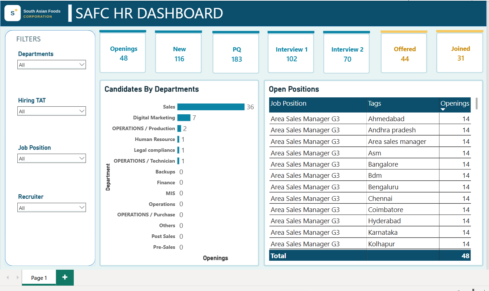

# SAFC HR Dashboard – Recruitment Pipeline

A Power BI dashboard built for and used by the HR team at **South Asian Foods Corporation Pvt. Ltd. (Mr. Goli Soda), Chennai**, to track the full recruitment pipeline from open positions to joining.

> **Note:** This is a real, in-use company dashboard. The Power BI (.pbix) file and the source data are **not included** in this repository because they contain confidential company and candidate information. Only a screenshot of the dashboard is shared, with no personal details shown.

## Business problem
The HR team tracked hiring in spreadsheets, which made it hard to see how many candidates were at each stage, which departments had the most candidates, and which positions were still open.

## Who uses it
- **HR recruiters** – daily follow-up of candidates by stage
- **HR Head** – candidates by department, open positions and hiring TAT
- **Management** – overall hiring progress

## What the dashboard shows
- **Recruitment pipeline (KPI cards):** Openings → New → PQ (Pre-Qualification) → Interview 1 → Interview 2 → Offered → Joined
- **Candidates by department:** horizontal bar chart showing every department, including those with zero candidates
- **Open positions:** table of job positions with tags and the number of openings, with a total
- **Filters:** Departments, Hiring TAT, Job Position, Recruiter

## How the data flows
1. HR updates the cleaned Excel file with new candidates and status changes.
2. Power BI is connected directly to this Excel file.
3. On refresh, the dashboard picks up the latest data automatically, with no manual rework.

## My role
- Gathered requirements from the HR team
- Cleaned and structured the raw recruitment data in Excel
- Connected Power BI to the cleaned Excel file, so every HR update shows in the dashboard on refresh
- Wrote DAX measures for each pipeline stage
- Designed the layout and a custom colour theme (light background, teal and gold) for readability
- Rebuilt the earlier version with a clearer layout, dropdown filters and readable labels

## Tools
Power BI Desktop · DAX · Excel

## Why the .pbix file and data are not shared
This dashboard runs on live HR data from SAFC, including candidate, recruiter and hiring details. To protect company and candidate confidentiality, the Power BI file and the Excel source data are kept private. The screenshot shows the design and features of the dashboard only.
